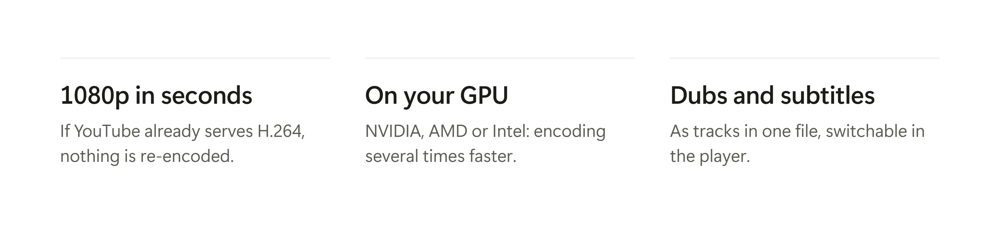

<p align="right"><b>English</b> · <a href="README.ru.md">Русский</a></p>

<p align="center">
  <picture>
    <source media="(prefers-color-scheme: dark)" srcset="docs/hero-dark.png">
    
  </picture>
</p>

<p align="center">
  <a href="https://github.com/DablyaOfficial/to-picture/releases/latest/download/ToPicture-Setup.exe"></a>
  <a href="https://github.com/DablyaOfficial/to-picture/releases/latest/download/ToPicture-Portable.zip"></a>
  &nbsp;<a href="https://github.com/DablyaOfficial/to-picture/releases">All versions</a>
</p>

<picture>
  <source media="(prefers-color-scheme: dark)" srcset="docs/features-dark.png">
  
</picture>

<p align="center">
  <br>
  <sub>Preview and settings</sub>
</p>

<p align="center">
  <br>
  <sub>Downloading and transcoding, dark theme</sub>
</p>

## Install

1. Download [`ToPicture-Setup.exe`](https://github.com/DablyaOfficial/to-picture/releases/latest/download/ToPicture-Setup.exe) and run it. No admin rights needed; a new version installs over the old one and keeps your settings.
2. If Windows says “Windows protected your PC”, click **More info** → **Run anyway**. The installer isn't signed with a paid certificate, hence the warning.

**Portable:** unzip [`ToPicture-Portable.zip`](https://github.com/DablyaOfficial/to-picture/releases/latest/download/ToPicture-Portable.zip) anywhere and run `To Picture.exe`. Settings stay next to it in the `data` folder, so it works from a USB stick.

yt-dlp and ffmpeg are included — nothing else to install. Windows 10 or 11, 64-bit. The WebView2 window engine is built into Windows 11; on Windows 10 the installer downloads it if needed.

**Languages:** English, 简体中文, Español, Português (Brasil), Deutsch, Français, 日本語, 한국어, Türkçe, Русский. The app follows your Windows language; change it in the **⋯** menu.

## How to use

1. Copy a video link and paste it into **Links** (Ctrl+V). You can add several, one per line.
2. Check the preview: quality, what it will be converted to, which audio tracks and subtitles go into the file. If a video has several dubs, you can tick the ones you want right in the preview — for that link only.
3. Click **Download** (Ctrl+Enter). **Show in folder** opens the finished file.

Everything else is in **Settings**: folder, codec, resolution, quality, encoder, audio tracks, subtitles. Theme and language are in the **⋯** menu.

## FAQ

**Which codec should I pick?**
H.264 if unsure — it opens everywhere. H.265 makes smaller files, ProRes 422 is for editing, “No re-encoding” keeps the file as YouTube serves it.

**Why is it sometimes done in seconds?**
If YouTube already serves H.264 at the chosen resolution (usually up to 1080p), the app only downloads and joins the tracks, with no re-encoding. YouTube serves 4K only as VP9/AV1, so 4K has to be re-encoded.

**Do I need a graphics card?**
No. With one, encoding is faster and uses almost no memory; without it, the processor does the work.

**Are auto-generated subtitles downloaded?**
No, only official ones. They're embedded as tracks and turned on in the player.

**Why .mkv and not .mp4?**
When subtitles are embedded, the file is saved as MKV: in MP4 the first subtitle track is always marked “on”, so players show it right away. MKV opens in VLC, MPC, PotPlayer and the Windows 11 Media Player. Need MP4 — turn subtitles off in **Settings**.

**A video won't download, error 403.**
Usually YouTube changed something and yt-dlp needs an update. The app updates it once a day and immediately after such an error — try again in a minute. Details are in the **Log** at the bottom of the window.

## Build from source

You'll need Python 3.12+, [Inno Setup 6/7](https://jrsoftware.org/isdl.php), plus `yt-dlp.exe` and ffmpeg ([yt-dlp build](https://github.com/yt-dlp/FFmpeg-Builds/releases), `win64-gpl-shared`) in `installer/payload/bin`.

```bat
pip install -r requirements.txt
python ToPicture.pyw       :: run from source
build_installer.bat        :: exe, installer and portable zip in installer\output
```

UI — [`ui/index.html`](ui/index.html) (HTML/CSS in a [pywebview](https://github.com/r0x0r/pywebview) window), translations — [`ui/locales/`](ui/locales), logic — [`ToPicture.pyw`](ToPicture.pyw), installer — [`installer/ToPicture.iss`](installer/ToPicture.iss).

**Translations:** each language is one JSON file in `ui/locales/` (`en.json` is the reference). To add a language, copy `en.json`, translate the values and open a pull request.

## Licenses

To Picture — [MIT](LICENSE). Bundled: [ffmpeg](https://ffmpeg.org) (GPL), [yt-dlp](https://github.com/yt-dlp/yt-dlp) (Unlicense) — details and source links in [THIRD-PARTY-NOTICES.md](THIRD-PARTY-NOTICES.md). Frames in the screenshots — Blender Studio, CC BY 4.0.

Only download what you have the rights to, and follow YouTube's terms.
