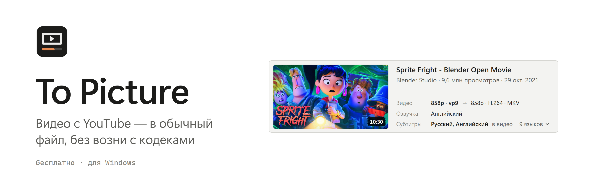
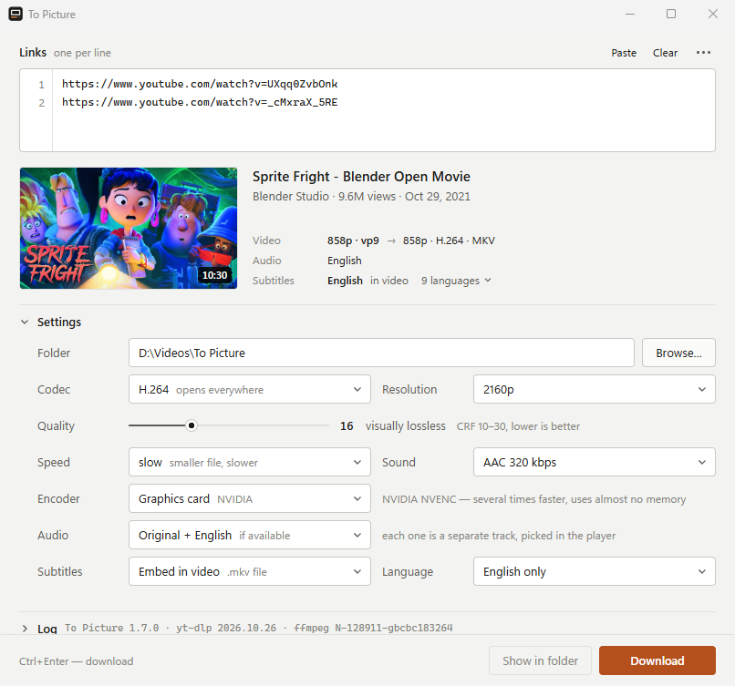
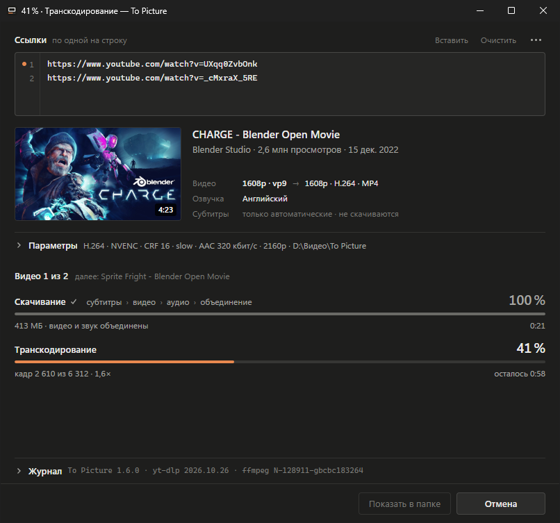

<p align="right"><b>English</b> · <a href="README.ru.md">Русский</a></p>

<p align="center">
  <picture>
    <source media="(prefers-color-scheme: dark)" srcset="docs/hero-dark.png">
    
  </picture>
</p>

<p align="center">
  <a href="https://github.com/DablyaOfficial/to-picture/releases/latest/download/ToPicture-Setup.exe"></a>
  <a href="https://github.com/DablyaOfficial/to-picture/releases/latest/download/ToPicture-Portable.zip"></a>
  &nbsp;<a href="https://github.com/DablyaOfficial/to-picture/releases">All versions</a>
</p>

<picture>
  <source media="(prefers-color-scheme: dark)" srcset="docs/features-dark.png">
  
</picture>

<p align="center">
  <br>
  <sub>Preview and settings</sub>
</p>

<p align="center">
  <br>
  <sub>Downloading and transcoding, dark theme</sub>
</p>

**Works with** YouTube, VK, TikTok, Twitch, Instagram, Dailymotion, Rutube, Coub, Weverse, SoundCloud (audio) and [1000+ other sites supported by yt-dlp](https://github.com/yt-dlp/yt-dlp/blob/master/supportedsites.md).

## Install

1. Download [`ToPicture-Setup.exe`](https://github.com/DablyaOfficial/to-picture/releases/latest/download/ToPicture-Setup.exe) and run it. No admin rights needed; a new version installs over the old one and keeps your settings.
2. If Windows says “Windows protected your PC”, click **More info** → **Run anyway**. The installer isn't signed with a paid certificate, hence the warning.

**Portable:** unzip [`ToPicture-Portable.zip`](https://github.com/DablyaOfficial/to-picture/releases/latest/download/ToPicture-Portable.zip) anywhere and run `To Picture.exe`. Settings stay next to it in the `data` folder, so it works from a USB stick.

yt-dlp and ffmpeg are included — nothing else to install. Windows 10 or 11, 64-bit.

**Languages:** English, 简体中文, Español, Português (Brasil), Deutsch, Français, 日本語, 한국어, Türkçe, Русский. The app follows your Windows language; change it in the **⋯** menu.

## How to use

1. Copy a video link from any supported site and paste it into **Links** (Ctrl+V). You can add several, one per line — or a playlist or channel link: the preview lists its videos, untick the ones you don't need.
2. Check the preview: quality, what it will be converted to, which audio tracks and subtitles go into the file. If a video has several dubs, you can tick the ones you want right in the preview — for that link only. **Clip** saves just a part of the video, cut exactly on the frame.
3. Click **Download** (Ctrl+Enter). **Pause** freezes downloading and encoding and resumes from the same spot. **Show in folder** opens the finished file.

Everything else is in **Settings**: folder, codec (or MP3 / FLAC / M4A for audio only), resolution, quality, encoder, audio tracks, subtitles, file name pattern, cutting out sponsor segments (SponsorBlock), sign-in to sites, proxy and speed limit. While one video is encoding, the next one is already downloading. Theme and language are in the **⋯** menu.

## Browser extension

A **To Picture** button and a right-click item (“Download in To Picture”) in Chrome, Edge, Brave, Vivaldi, Opera and Yandex Browser send the video straight to the app — it opens if it was closed. If a site needs sign-in, the extension passes your sign-in along with the link, so members-only and age-restricted videos download the same way you see them.

1. In the installer, keep **Browser extension** checked (portable version: **⋯ → Browser extension → Connect**).
2. Open `chrome://extensions` (or `edge://extensions`) and turn on **Developer mode**.
3. Click **Load unpacked** and choose the `extension` folder — the app shows its path and copies it for you (**⋯ → Browser extension**).

Browsers don't let apps install extensions silently, so steps 2–3 are done once by hand. The extension updates together with the app.

## FAQ

**Which codec should I pick?**
H.264 if unsure — it opens everywhere. H.265 makes smaller files, ProRes 422 is for editing, “No re-encoding” keeps the file as YouTube serves it.

**Why is it sometimes done in seconds?**
If the site already serves H.264 at the chosen resolution (YouTube usually does up to 1080p), the app only downloads and joins the tracks, with no re-encoding. YouTube serves 4K only as VP9/AV1, so 4K has to be re-encoded.

**Do I need a graphics card?**
No. With one, encoding is faster and uses almost no memory; without it, the processor does the work.

**Which sites work?**
Everything [yt-dlp supports](https://github.com/yt-dlp/yt-dlp/blob/master/supportedsites.md) — over a thousand sites. Checked: YouTube, VK, TikTok, Twitch, Instagram, Dailymotion, Rutube, Coub, Weverse; SoundCloud and other audio-only links are saved as `.m4a`. For sites that show the video only to signed-in users (Vimeo, Reddit, members-only and age-restricted videos), see the next question.

**How do I download a video that needs sign-in?**
Easiest: send the link with the [browser extension](#browser-extension) — it passes your sign-in from the browser, and the app uses it only if the site asks for it. Or turn on **Settings → Sign in to sites**. *Firefox*: sign in to the site in Firefox, and the app uses its cookies. *cookies.txt file*: for Chrome, Edge and other Chromium browsers — Windows encrypts their cookies so no app can read them directly, so export a `cookies.txt` with an extension such as “Get cookies.txt LOCALLY” and pick the file. The app works with a copy and never changes it.

**Are auto-generated subtitles downloaded?**
No, only official ones. They're embedded as tracks and turned on in the player.

**Why .mkv and not .mp4?**
When subtitles are embedded, the file is saved as MKV: in MP4 the first subtitle track is always marked “on”, so players show it right away. MKV opens in VLC, MPC, PotPlayer and the Windows 11 Media Player. Need MP4 — turn subtitles off in **Settings**.

**A video won't download, error 403.**
Usually YouTube changed something and yt-dlp needs an update. The app updates it once a day and immediately after such an error — try again in a minute. Details are in the **Log** at the bottom of the window.

## Build from source

You'll need [Rust](https://rustup.rs) with Visual Studio C++ Build Tools, [Inno Setup 6/7](https://jrsoftware.org/isdl.php), plus `yt-dlp.exe` and ffmpeg ([yt-dlp build](https://github.com/yt-dlp/FFmpeg-Builds/releases), `win64-gpl-shared`) in `installer/payload/bin`.

```bat
cargo run -p topicture      :: run from source
build_installer.bat         :: exe, installer and portable zip in installer\output
```

Written in Rust. Window — [`crates/app`](crates/app) (native UI on [Slint](https://slint.dev), no WebView), engine — [`crates/core`](crates/core), browser extension link — [`crates/bridge`](crates/bridge), translations — [`ui/locales/`](ui/locales), installer — [`installer/ToPicture.iss`](installer/ToPicture.iss).

[](https://slint.dev)

**Translations:** each language is one JSON file in `ui/locales/` (`en.json` is the reference). To add a language, copy `en.json`, translate the values and open a pull request.

## Licenses

To Picture — [MIT](LICENSE). Bundled: [ffmpeg](https://ffmpeg.org) (GPL), [yt-dlp](https://github.com/yt-dlp/yt-dlp) (Unlicense) — details and source links in [THIRD-PARTY-NOTICES.md](THIRD-PARTY-NOTICES.md). Frames in the screenshots — Blender Studio, CC BY 4.0.

Only download what you have the rights to, and follow YouTube's terms.
