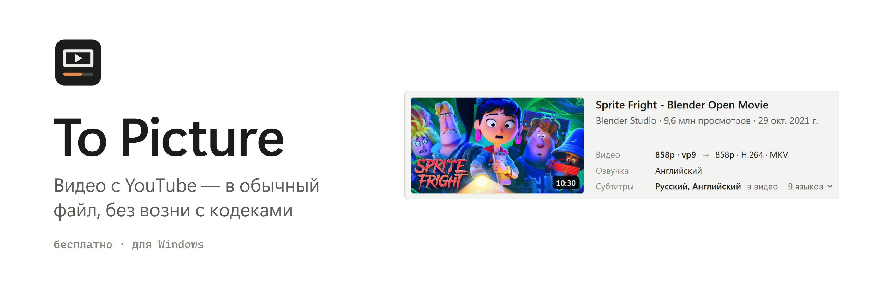
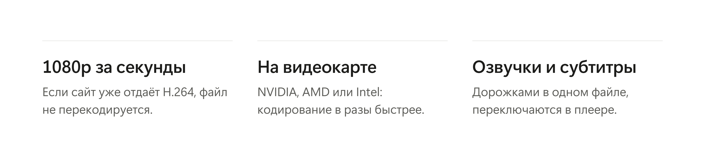
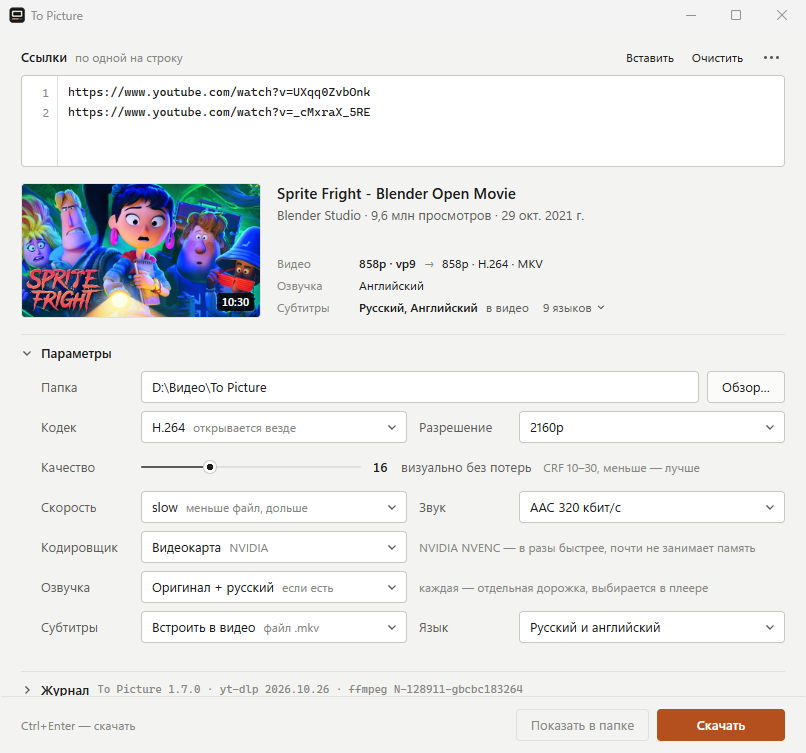
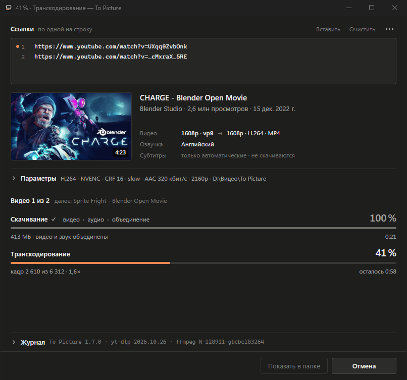

<p align="right"><a href="README.md">English</a> · <b>Русский</b></p>

<p align="center">
  <picture>
    <source media="(prefers-color-scheme: dark)" srcset="docs/hero-dark-ru.png">
    
  </picture>
</p>

<p align="center">
  <a href="https://github.com/DablyaOfficial/to-picture/releases/latest/download/ToPicture-Setup.exe"></a>
  <a href="https://github.com/DablyaOfficial/to-picture/releases/latest/download/ToPicture-Portable.zip"></a>
  &nbsp;<a href="https://github.com/DablyaOfficial/to-picture/releases">Все версии</a>
</p>

<picture>
  <source media="(prefers-color-scheme: dark)" srcset="docs/features-dark-ru.png">
  
</picture>

<p align="center">
  <br>
  <sub>Превью и параметры</sub>
</p>

<p align="center">
  <br>
  <sub>Скачивание и перекодирование, тёмная тема</sub>
</p>

**Работает с** YouTube, VK, TikTok, Twitch, Instagram, Dailymotion, Rutube, Coub, Weverse, SoundCloud (звук) и [ещё тысячей сайтов, которые поддерживает yt-dlp](https://github.com/yt-dlp/yt-dlp/blob/master/supportedsites.md).

## Установка

1. Скачайте [`ToPicture-Setup.exe`](https://github.com/DablyaOfficial/to-picture/releases/latest/download/ToPicture-Setup.exe) и запустите. Права администратора не нужны; новая версия ставится поверх старой, настройки сохраняются.
2. Если Windows покажет «Система Windows защитила ваш компьютер», нажмите **Подробнее** → **Выполнить в любом случае**. Установщик не подписан платным сертификатом — поэтому и предупреждение.

**Portable:** распакуйте [`ToPicture-Portable.zip`](https://github.com/DablyaOfficial/to-picture/releases/latest/download/ToPicture-Portable.zip) в любую папку и запустите `To Picture.exe`. Настройки хранятся рядом, в папке `data`, — можно носить на флешке.

yt-dlp и ffmpeg уже внутри, ставить ничего не нужно. Windows 10 или 11, 64-бит.

**Языки:** English, 简体中文, Español, Português (Brasil), Deutsch, Français, 日本語, 한국어, Türkçe, Русский. Программа берёт язык Windows; поменять — в меню **⋯**.

## Как пользоваться

1. Скопируйте ссылку на видео с любого поддерживаемого сайта и вставьте её в поле «Ссылки» (Ctrl+V). Можно несколько, по одной на строку, — или ссылку на плейлист или канал: в превью появится список видео, ненужные можно снять.
2. Проверьте превью: качество, во что перекодируется, какие озвучки и субтитры попадут в файл. Если у видео несколько озвучек, нужные можно отметить прямо в превью — только для этой ссылки. **Фрагмент** сохраняет только часть видео, точно по кадру.
3. Нажмите **Скачать** (Ctrl+Enter). **Пауза** замораживает загрузку и перекодирование и продолжает с того же места. Готовый файл откроется кнопкой **Показать в папке**.

Всё остальное — в разделе **Параметры**: папка, кодек (или MP3 / FLAC / M4A, если нужен только звук), разрешение, качество, кодировщик, озвучки, субтитры, имя файла, вырезание рекламных вставок (SponsorBlock), вход на сайты, прокси и лимит скорости. Пока одно видео перекодируется, следующее уже скачивается. Тема и язык — в меню **⋯**.

## Расширение для браузера

Кнопка **To Picture** и пункт в меню правой кнопки («Скачать в To Picture») в Chrome, Edge, Brave, Vivaldi, Opera и Яндекс Браузере отправляют видео прямо в программу — если она закрыта, она откроется. Если сайту нужен вход, расширение передаст ваш вход вместе со ссылкой: видео для спонсоров и 18+ скачаются так же, как вы их видите.

1. В установщике оставьте галочку **Расширение для браузера** (портативная версия: **⋯ → Расширение для браузера → Подключить**).
2. Откройте `chrome://extensions` (или `edge://extensions`) и включите **Режим разработчика**.
3. Нажмите **Загрузить распакованное** и выберите папку `extension` — программа покажет путь и скопирует его (**⋯ → Расширение для браузера**).

Браузеры не дают программам ставить расширения молча, поэтому шаги 2–3 делаются один раз вручную. Обновляется расширение вместе с программой.

## Частые вопросы

**Какой кодек выбрать?**
H.264, если не уверены: такой файл открывается везде. H.265 — меньше файл, ProRes 422 — для монтажа, «Без перекодирования» — как на YouTube.

**Почему иногда готово за секунды?**
Если сайт уже отдаёт H.264 нужного разрешения (YouTube — обычно до 1080p), программа только скачивает и склеивает дорожки, без перекодирования. 4K YouTube отдаёт только в VP9/AV1 — его приходится перекодировать.

**Нужна ли видеокарта?**
Нет. С ней кодирование быстрее и почти не занимает память; без неё работает процессор.

**С какими сайтами работает?**
Со всеми, что [поддерживает yt-dlp](https://github.com/yt-dlp/yt-dlp/blob/master/supportedsites.md), — их больше тысячи. Проверено: YouTube, VK, TikTok, Twitch, Instagram, Dailymotion, Rutube, Coub, Weverse; SoundCloud и другие ссылки без видео сохраняются как `.m4a`. Про сайты, которые показывают видео только после входа (Vimeo, Reddit, видео для спонсоров и 18+), — следующий вопрос.

**Как скачать видео, для которого нужен вход?**
Проще всего — отправить ссылку [расширением для браузера](#расширение-для-браузера): оно передаёт ваш вход из браузера, а программа использует его, только если сайт его просит. Или включите **Параметры → Вход на сайты**. *Firefox*: войдите на сайт в Firefox — программа возьмёт его cookies. *Файл cookies.txt*: для Chrome, Edge и других браузеров на Chromium — Windows шифрует их cookies так, что напрямую их не прочитать никакой программе, поэтому выгрузите `cookies.txt` расширением вроде «Get cookies.txt LOCALLY» и выберите файл. Программа работает с копией и сам файл не меняет.

**Скачиваются ли автоматические субтитры?**
Нет, только официальные. Они встраиваются в файл дорожками и включаются в плеере.

**Почему файл .mkv, а не .mp4?**
Когда в видео встроены субтитры, программа сохраняет его в MKV: в MP4 первые субтитры всегда помечаются как «включены», и плееры показывают их сразу. MKV открывают VLC, MPC, PotPlayer и «Медиаплеер» Windows 11. Нужен MP4 — выключите субтитры в **Параметрах**.

**Видео не скачивается, ошибка 403.**
Обычно YouTube что-то поменял, и нужен свежий yt-dlp. Программа обновляет его сама раз в сутки и сразу при такой ошибке — попробуйте ещё раз через минуту. Подробности — в разделе **Журнал** внизу окна.

## Сборка из исходников

Нужны [Rust](https://rustup.rs) с Visual Studio C++ Build Tools, [Inno Setup 6/7](https://jrsoftware.org/isdl.php), а также `yt-dlp.exe` и ffmpeg ([сборка yt-dlp](https://github.com/yt-dlp/FFmpeg-Builds/releases), `win64-gpl-shared`) в папке `installer/payload/bin`.

```bat
cargo run -p topicture      :: запуск из исходников
build_installer.bat         :: exe, установщик и portable zip — в installer\output
```

Написано на Rust. Окно — [`crates/app`](crates/app) (нативный интерфейс на [Slint](https://slint.dev), без WebView), движок — [`crates/core`](crates/core), связь с расширением — [`crates/bridge`](crates/bridge), переводы — [`ui/locales/`](ui/locales), установщик — [`installer/ToPicture.iss`](installer/ToPicture.iss).

[](https://slint.dev)

**Переводы:** каждый язык — один JSON-файл в `ui/locales/` (образец — `en.json`). Чтобы добавить язык, скопируйте `en.json`, переведите значения и пришлите pull request.

## Лицензии

To Picture — [MIT](LICENSE). В комплекте: [ffmpeg](https://ffmpeg.org) (GPL), [yt-dlp](https://github.com/yt-dlp/yt-dlp) (Unlicense) — подробности и ссылки на исходники в [THIRD-PARTY-NOTICES.md](THIRD-PARTY-NOTICES.md). Кадры на скриншотах — Blender Studio, CC BY 4.0.

Скачивайте только то, на что у вас есть права, и соблюдайте условия YouTube.
